<p align="center">
  
</p>

<h1 align="center">Splashdown</h1>

<p align="center">
  <strong>Your voice, for everything.</strong><br>
  Type in any app, tell your computer what to do, hear text read back, and turn anything you hear into notes. Free and open source for Mac and Windows: no subscription, no account, and it can all run on your computer.
</p>

<p align="center">
  <a href="https://splashdown.app">Website</a> ·
  <a href="#install">Install</a> ·
  <a href="#everything-it-does">Features</a> ·
  <a href="#private-by-default">Privacy</a> ·
  <a href="docs/TROUBLESHOOTING.md">Troubleshooting</a> ·
  <a href="CHANGELOG.md">Changelog</a> ·
  <a href="https://github.com/bhowerton/splashdown/issues">Issues</a>
</p>

<p align="center">
  <a href="https://github.com/bhowerton/splashdown/releases/latest"></a>
  <a href="#what-you-need"></a>
  <a href="#license"></a>
  <a href="https://github.com/bhowerton/splashdown/releases"></a>
  <a href="https://github.com/bhowerton/splashdown/actions/workflows/ci.yml"></a>
</p>

<p align="center">
  <a href="https://github.com/bhowerton/splashdown/releases/latest/download/Splashdown-mac.dmg"></a>
  <a href="https://github.com/bhowerton/splashdown/releases/latest/download/Splashdown-windows-x64-setup.exe"></a>
</p>

<p align="center">
  
</p>

## Why Splashdown

- **Free and open source, for good.** No subscription, no account, no word limits. Your own API key costs cents a month, and you can set a spending limit.
- **Works everywhere you type.** Email, Slack, Messages, docs, the browser, your terminal or code editor: any text field in any app.
- **Talks like you do, writes like you meant to.** The "um"s and do-overs disappear, and you can say "make it more formal", "turn that into a list" or "translate to Spanish", in any language.
- **Says what to do, not just what to write.** "Open Spotify", "remind me at 5 to stretch", "add dentist to my calendar on Thursday at 4", "pause the music", or your own: "deploy staging", "next slide". Nothing is sent, deleted or bought for you.
- **Speaks their language.** Hold the key and tap T to write in Spanish, French or any language you pick, or let it reply in the language of the email or chat on screen.
- **Reads to you, too.** Select text and say "read this to me", or "read me a summary of this", and it's read aloud in a natural voice that runs on your computer.
- **Turns anything you hear into notes.** Pick any app (a webinar in your browser, a podcast, a video, a call you're only listening to) and what it says is written into a note as it plays. Record meetings without a bot joining (and have the people you've named recognized next time), transcribe voice memos, YouTube links and whole folders, save subtitles, and ask your notes questions. Notes are plain Markdown files.
- **Follows up for you.** A brief before each meeting from your last notes about it, your to-dos as reminders and the follow-up email as a draft when it ends, a weekly review on Friday: hooks you set up once, in your own words.
- **Private when you want it.** Run it entirely on your computer with Apple's built-in models or the included local models, so nothing leaves your machine.

<p align="center">
  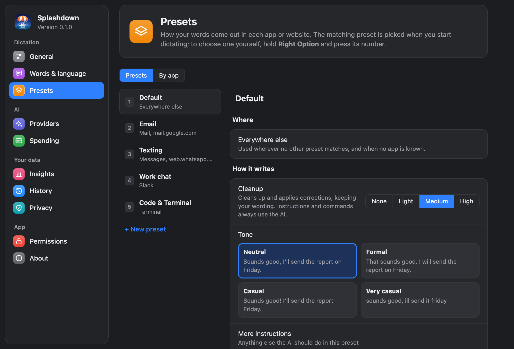
  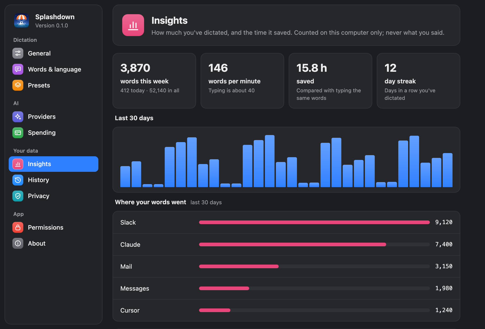
  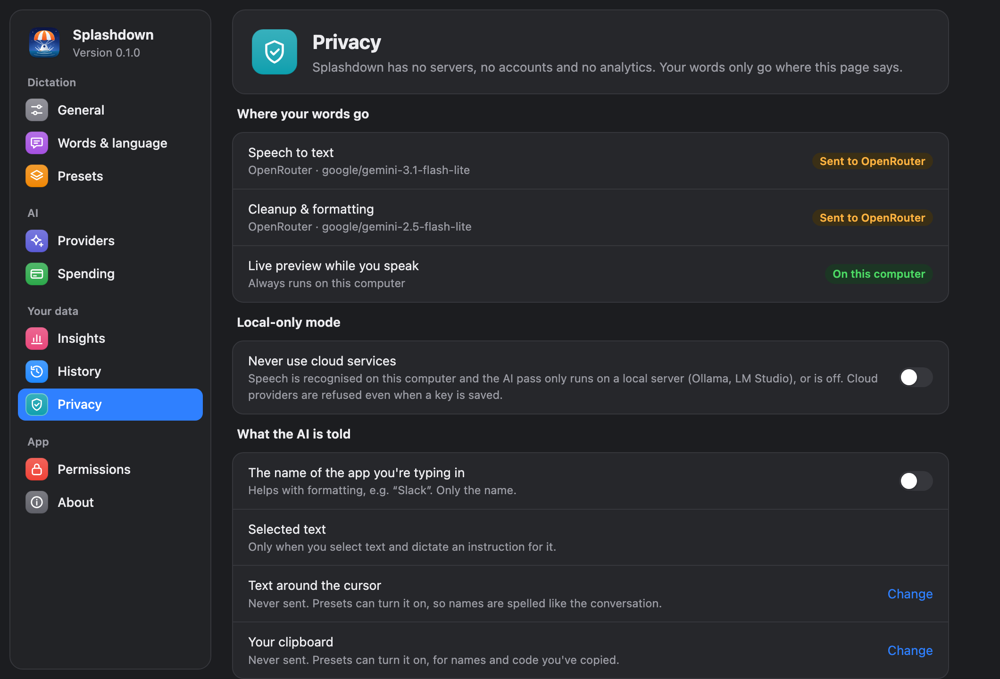
</p>

<p align="center">
  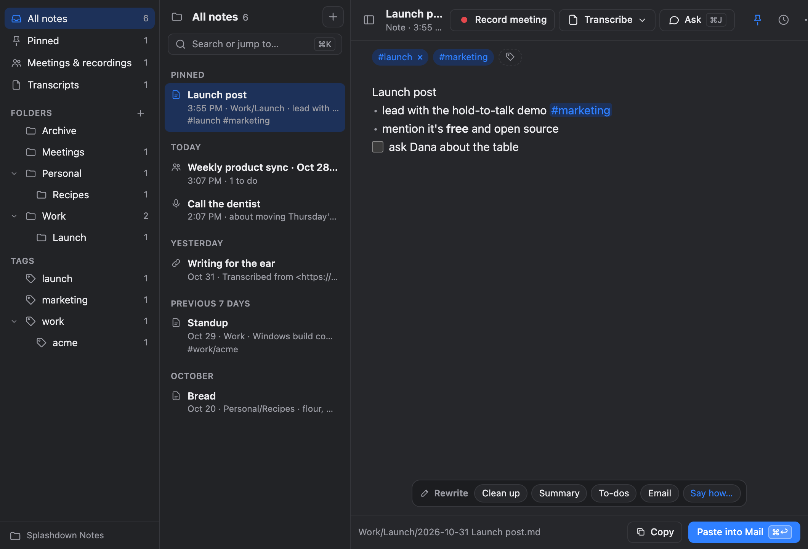
  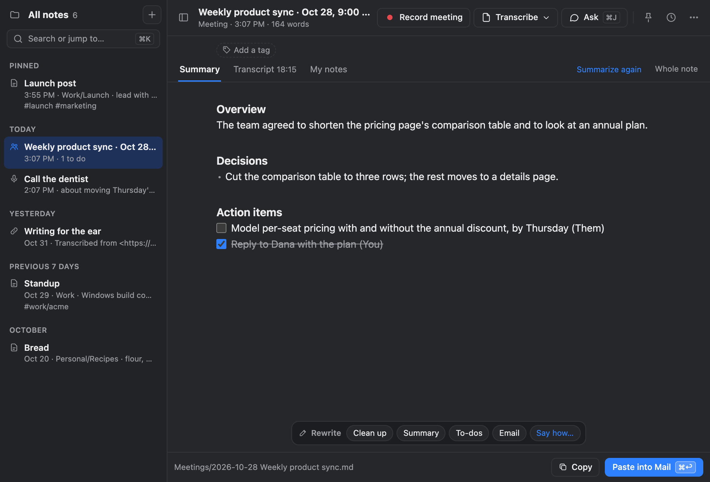
  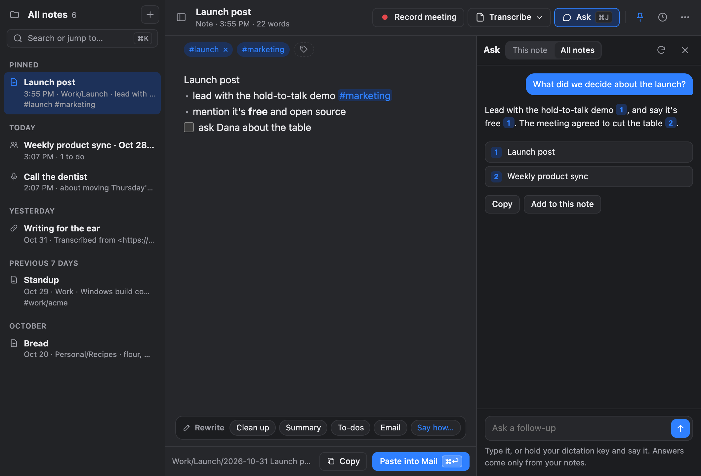
</p>

## Everything it does

### Dictate anywhere

- **Hold to talk.** Hold **Right Option** (Right Ctrl on Windows), speak, let go. The text lands in whatever field has focus, with a space before it when it needs one.
- **Clean, not rewritten.** The AI pass removes fillers and false starts and fixes punctuation, at the level you choose per app: none, light, medium or high. Spoken formatting ("new paragraph", "comma") works in any language.
- **No waiting for the AI:** with a cloud AI, its text is typed as it's written, starting a moment after you let go.
- **Live text while you speak** with speech-to-text on your computer: Nemotron writes as you speak, and your text is ready the moment you let go.
- **Hands-free** for long dictations: hold the key and press **H**, then let go. Stops on its own after 3 minutes of silence.
- **Straight into a note:** hold the key and press **N**, and what you say is added to your Inbox (or today's daily note) instead of typed, each day's lines under a heading for the day. ⌃⌥Z takes it back.
- **Music steps aside.** Other sounds are turned down while you speak, as with Siri, or muted or paused if you prefer. On audio interfaces whose volume can't be changed, the music is paused instead.
- **Whisper mode** for speaking quietly, **mixed languages** in one sentence, and **background noise removed** (fans, traffic, café chatter) on your computer before your speech is transcribed, if you turn it on.

### Talk to it

<p align="center">
  
</p>

- **Instructions while you dictate.** Tap **Right Shift** mid-dictation and say what to do: "make it a bulleted list", "make it an email".
- **Spoken commands, in any language.** Hold Right Option and tap Right Shift *before* speaking: "delete that last sentence", "make that more formal", "envíalo". The AI works out what you meant; nothing depends on exact phrases. Editing commands need an app that lets Splashdown read and select its text; when one doesn't, it says so rather than guess.
- **Voice actions.** Turn them on in Settings → Actions, and the same commands can do things: "open Spotify", "remind me at 3 to call Sam", "add dentist to my calendar on Thursday at 4", "search YouTube for paella recipes", "pause the music", "start recording the meeting", or, with text selected, "email this to Sam". "Undo that" takes back an event, reminder or to-do. Nothing is sent, deleted or bought for you: an email opens as a draft, and a Shortcut asks before it runs.
- **Your own actions.** Give a link, a script or program, or keys to press a name, and say it: "deploy staging", "next slide", "open issue ENG-42" (whatever you say after the name can go into the link or the script). Splashdown shows exactly what will run and asks first, until you choose Always allow.
- **Hooks** do something when something happens, without being asked each time: [see below](#hooks-when-something-happens).
- **"What can I say?"** Say it (or "help") for a window with everything you can say or press, with your own keys and actions. Also in the menu bar under Help.
- **Rewrite a selection.** Select text, hold the key, say what to change.
- **Undo the AI.** **⌃⌥Z** right after it's typed swaps in exactly what you said; **⌃⌥V** pastes your last raw words.

### A style for every app

- **Presets** switch on their own by app, window title or website: Default, Email, Texting, Work chat, Code & Terminal, Notes, and your own. Each sets the tone, cleanup level, spoken language, translation, its own AI model, and whether to press Return when done.
- **Context, only if you want it.** A preset can read the text around the cursor or your clipboard so names are spelled like the thread. Both are off unless you turn them on.
- **Words that stick.** Names and terms in the window you're typing in (the email or chat on screen) are spelled right without adding them anywhere. A vocabulary list that learns from one correction (fix "Pria" to "Priya" once and it's learned, with a note saying so and one click to forget it), snippets with fill-ins (`{date}`, `{clipboard}`), and find-and-replace rules.
- **Bring your words, share your presets.** Settings → Words & language → Import… brings the vocabulary, corrections and snippets from another dictation app's export, a word list or a CSV file. Share… on a preset saves it as a small file anyone can import.

### On your computer or in the cloud

- **Your own key:** OpenAI, OpenRouter or Anthropic, with a monthly spending limit. Typical use costs cents a month.
- **Fully on your computer:** Apple's on-device speech and language models (Apple Silicon, macOS 26), or local speech-to-text (Nemotron, which writes as you speak, or Parakeet and Whisper) plus Splashdown's built-in local model, a free download with nothing else to install. Ollama and LM Studio work too.
- **Quick even on an older PC.** The built-in model uses the processor's fast instructions on Windows and Intel Macs, and the graphics chip on Windows (Vulkan) where there is one. Setup times it on your computer, and if it's slow, says so and suggests a cloud key.
- **A stand-in when the cloud fails.** If your provider is offline or out of credit, the dictation is retried on your computer, and the result says so.
- Smaller on-device models handle cleanup well but follow instructions less reliably than cloud models, so instructions can be sent to the cloud while plain dictation stays local.

### Ask a question

- **Hold the key, press A, ask.** "What's the German word for deadline?", or select text first and ask "what does this say?". The answer appears in a small panel with Insert and Copy, and can draw on your notes ("what did we decide about the launch?"). Follow-ups carry on the conversation.

### Write it for me

- **Say what to write, not the words.** Hold Right Option, tap **Right Shift** and say "reply saying I'm in and ask about parking", "tell the team the launch moved to Thursday" or "decline politely and suggest next month". It's written straight into the reply, for the app you're in and the message you're answering, in your language. There's no need to select the message: Splashdown reads the conversation around where you're typing (the email thread or chat on screen), on your computer. Settings → Privacy turns reading the window off.
- **Sounds like you.** Drafts follow your own messages in the conversation (your greeting, sign-off, capitals, emoji), and Compose learns from how you edit its drafts before sending, separately for email, work chat and texts. Settings → Words & language shows what it learned, to change or forget.
- **Change it by voice:** select the draft and say "shorter" or "warmer", or "scratch that" to take it back. To check drafts first, turn on Check drafts in a panel first: you can change the draft there by voice ("add that I'm free Thursday", "in German") and every version is kept until you Insert it.
- **No made-up facts.** Names, dates, numbers and your own details come only from what you said, the message and your notes; anything missing is left as a [placeholder]. Instructions for an AI hidden in the message you're answering are left out before anything is written.

### Translate

<p align="center">
  
</p>

- **Dictate in another language.** Hold the dictation key, tap **T** and speak: it comes out in the language ticked in the menu bar under Translate into. Tap **T** again for the next of your languages. The first time, pick one from a short list; choose up to five in Settings → Words & language.
- **Reply in their language.** Turn it on in Settings → Words & language, and in email and chat a conversation that's clearly in another language gets your dictation in that language, with no key to press: the bar says "→ German (their language)" while you speak. It reads only the messages (not the app's labels or a quoted thread), and does nothing when the conversation is mixed or too short to tell.
- **Translate what you select.** Select text in any app, hold the dictation key and tap T. In your own text it's replaced by the translation; in text you can't edit (a web page, an email you received) the translation opens in the Ask panel, where Read aloud reads it in that language. ⌃⌥T does the same without holding a key.
- **A preset can always translate** (Settings → Presets → Translate into), and "translate that to Spanish" works as a spoken command.

### Hear it read back

- **"Read this to me."** Select text, hold Right Option and say it, and it's read aloud. With nothing selected, tap Right Shift first and the text you're writing is read, or your last dictation (also in the menu bar: Last dictation → Read it to me).
- **"Read me a summary of this."** Your AI writes a short summary meant for listening, and it's read as it's written, so the voice starts after the first sentence. "Read this to me in Spanish" translates as it reads. "Read me the action items" and other questions work the same way, and the answer stays in the Ask panel, which has a Read aloud button for any answer.
- **A natural voice, on your computer.** Phonon 31M (Gradium, Apache-2.0), a 68 MB download with 25 American and British voices, reads English with numbers, dates and amounts said properly, and starts speaking in a fraction of a second even on a slow PC. Other languages use the best system voice for that language. Music pauses while it reads, and Esc stops it. Settings → AI Models → Text to speech.

### Notes

- **⌃⌥N opens Notes**, for when there's no text field around. Every note is a plain Markdown file in a folder you choose, so Obsidian, iCloud Drive and Dropbox work, and nothing is locked in.
- **On all your devices.** Settings → General → Notes → Keep them in moves your notes to iCloud Drive, Dropbox, Google Drive or OneDrive in one click, whichever this computer has. They stay on your computer unless you choose one.
- **Notes from your iPhone.** The [Splashdown Note shortcut](https://splashdown.app/iphone/) turns what you say on your phone (from the Action Button, the Lock Screen or Siri) into a note that's added to your Inbox or today's note, through your iCloud Drive, while Splashdown runs on your Mac or PC. No app to install.
- **Folders and tags.** Nested folders (the real ones on disk) and Obsidian-style `#tags`, nested with `/`, in a column with counts. Drag a note onto a folder, or use Move to….
- **Formatting as you write:** headings, bullets and checkboxes you can click, with the Markdown marks out of the way.
- **⌘K** finds any note, folder or tag, and anything the window can do. **⌘T** opens today's note, and beside Pinned there are To do (notes with an unticked box), Changed today and Untagged.
- **Rewrites you check before keeping.** Clean up, Summary, To-dos, Email, Prompt for an AI, or your own; the result shows what changed, and you keep it or say what to change ("warmer", "in French"). Give one a shortcut to use it on selected text in any app.
- **Ask your notes (⌘J)** about one note or all of them; answers link to the notes they came from. Turn on Find notes by meaning and Ask finds the notes about what you mean, not only ones with the same words, on your computer.
- Pins, earlier versions you can restore, and **Paste into** (⌘↩), which pastes the note into the app you used last.

### Any app's audio, meetings and transcripts

<p align="center">
  
</p>

- **Meeting notes without a bot.** ⌃⌥M (or Record meeting) records your microphone and what your computer plays, and writes the conversation into a note as it goes, each turn marked You or Them; at the end the other people can be told apart and named, and with your calendar the note takes the meeting's title. Write your own notes beside the live transcript, ask "What did I miss?", and get a summary of decisions, action items and open questions at the end, built around what you wrote down; the AI on your computer summarizes an hour-long meeting too, a part at a time. A kept recording plays back from any turn, and can be transcribed again with another speech model. When Zoom, Teams, Meet or another call app starts using the microphone, Splashdown offers to record, says what recording will do with your settings and reminds you to let people know; "Don't offer for Zoom" turns it off for that app only. On a Mac it can also offer a meeting on your calendar two minutes before it starts, with Join for its Zoom, Meet, Teams or Webex link beside Record (Settings → General → Meetings; off until you turn it on).
- **Remembers who's who (Mac).** Name a speaker once (Speaker 2 → Priya, from the people invited or typed, or Them on a one-on-one call), and turn on Settings → General → Meetings → Recognize people you've named: in later meetings she's named by her voice when it's a clear match, and anyone new stays Speaker 1, 2. Voiceprints stay on your computer, never in your notes, and Settings lists them with Forget.

<p align="center">
  
</p>

- **Carry on a meeting that stopped.** A meeting that ended too soon, or picked up again after a break, doesn't need a second note. Carry on recording (the note's menu in the list, or ⌘K) records more into the same note: a line marks where it picked up, the new turns are timed from where it stopped, and the summary is written again from all of it. A kept recording stays one recording, so it still plays from any turn.

<p align="center">
  
</p>

- **Transcribe an app's audio:** a webinar in the browser, a podcast app, a call you're only listening to. Only that app's sound is recorded, with a level meter that says whether it's hearing words.
- **Transcribe the microphone** for a lecture or a conversation in the room, hands-free.
- **Transcribe files and links:** drop a voice memo, interview or video onto Notes, or paste a YouTube or podcast link.
- **Watched folders:** choose folders in Settings → General → Transcribe new files in a folder, and new audio and video files that arrive there (a Zoom recordings folder, a recorder's imports) become transcript notes once they've finished copying, with subtitles saved next to them if you like. Files already there are left alone unless you ask, and nothing is done twice.
- **Subtitles:** save any transcript or meeting as SRT or VTT subtitles from the note's menu or ⌘K. Transcribed on this computer, each caption is timed to the words; with cloud speech the times are estimated.

<p align="center">
  
</p>

### Hooks: when something happens

<p align="center">
  
</p>

Settings → Actions → When something happens. A hook runs after a meeting, a transcript, a dictation or a note from your iPhone, at a time you set, or before a meeting on your calendar. Details and examples: [docs/HOOKS.md](docs/HOOKS.md).

- **Ask the AI, in your own words.** "Draft the follow-up email." "List what I said I'd do." No script needed, and the common ones are ready to start from: the follow-up email, your commitments, decisions, key points, study cards, to-dos from a note said on your iPhone.
- **Put the result where you'll use it:** in the meeting's note, at the end of another note or a file, on the clipboard, at a web address, as reminders in a list you name (Mac), or as an email draft that opens for you to check and send.
- **On a schedule.** A weekly review on Friday afternoon or a daily wrap-up, from the notes you made in the last 7 days or the last day. A time that passes while the computer sleeps is caught up on.
- **A brief before each meeting (Mac).** A few minutes before a meeting on your calendar, the AI reads your notes from the last times you met (the same title, or mostly the same people) and says what was decided, what you said you'd do and what others said they'd do.
- **Told when it's done, run when you say.** A small panel shows what a hook wrote, with a button to open the note. Run now in Settings, or say "run my weekly review".
- **Your own script, or a web address.** A program gets the text as its input, never through a shell; a web address (Zapier, Make, n8n, a Slack incoming webhook) gets signed JSON. A script can also fix a preset's dictations before they go in.
- **Nothing happens behind your back.** A hook's AI can only write: an email is a draft, never sent, and nothing said in a meeting can add a recipient. Settings says exactly what each hook will run, and one that came from anywhere else (an imported settings file) asks before its first run. A hook asks once before its text goes to a cloud AI, Test tries one before you save it, and What ran lists what your hooks did.

### Everything else

- **A dictation is never lost.** If the speech service or the AI fails, or Splashdown closes mid-way, the recording is kept and **Retry** (menu bar → Last dictation) turns it into text. A cloud provider that's down is stood in for by a model on your computer.
- **History** (off by default; optionally with recordings, so you can transcribe again later), **Insights** (words, speed, time saved, streaks), and the **dictation pill**: a small pill at the bottom of your screen to click instead of holding a key, whose dots show the sound while it listens. Setup shows it once; drag it anywhere, or turn it off.
- **Warns when the microphone hears nothing**, and keeps what you said if it's unplugged mid-sentence.
- **Updates** are checked daily and installed only when you choose.
- **A setup guide that has you try it.** The first run shows what Splashdown does, gets speech to text ready in about a minute (the AI follows in the background, and is optional), then has you try the main things one at a time: dictate, dictate in one of your own apps, change selected text, hear it read back, and do things. Each ticks off when it works, and any can be skipped.

### For developers

- **Coding agents:** file names you say become `@file` mentions for Claude Code or Cursor, and `splashdown-mcp` lets an agent ask you a question by voice and, if you allow it, search, read and add to your notes, go through your meetings by date ("recap my meetings this week"), and, with a switch of its own, search what you dictated ([docs/AGENTS.md](docs/AGENTS.md)).
- **Shortcuts (Mac):** Dictate Text, Add to Note, Record a Voice Note, Start or Stop Dictation, Start Meeting and Stop Meeting (which can wait for the finished note), Find Notes, Get Note Text (a section, or subtitles), Ask My Notes, Transcribe File and Open Note, as actions in your own shortcuts. Settings → Privacy → Shortcuts turns off reading notes.
- **Scripting:** `splashdown://toggle` links for Raycast, Alfred or Shortcuts; `splashdown-cli toggle` and `splashdown-cli listen` from a terminal; mouse side buttons as the dictation key. `splashdown-cli` comes with the app: Settings → About shows where (on a Mac, `/Applications/Splashdown.app/Contents/MacOS/splashdown-cli`). To type just `splashdown-cli`, link it into a folder on your PATH, for example `ln -s /Applications/Splashdown.app/Contents/MacOS/splashdown-cli ~/.local/bin/`.

<details>
<summary><strong>All the keys</strong></summary>

| To | Do |
|---|---|
| Dictate | Hold **Right Option**, speak, let go |
| Add an instruction | While holding, tap **Right Shift**, then say it ("make it a bulleted list") |
| Edit or send by voice | While holding, tap **Right Shift** *before* saying anything, then say the command ("delete that last sentence", "capitalize that", "send it") |
| Rewrite selected text | Select text, hold Right Option, say what to do with it |
| Press Return when it's typed | Tap **Return** while holding, or right after letting go (again to undo) |
| Go hands-free | While holding **Right Option**, press **H**, then let go; tap Right Option once more to finish (double-tap can be turned on in Settings) |
| Add to your notes instead of typing | While holding, press **N**; ⌃⌥Z right after takes it back |
| Ask a question | While holding, press **A**, then ask |
| Have a message written | While holding, tap **Right Shift**, then say what to write ("reply saying I'm in"); select it and say "shorter" to change it |
| Hear text read aloud | Select it, hold **Right Option** and say "read this to me" (or "read me a summary of this"); **Esc** stops it. Or menu bar → Last dictation → **Read it to me** |
| Record a meeting | **⌃⌥M** (again to stop) |
| Run a hook now | While holding, tap **Right Shift** and say "run my weekly review", or Settings → Actions → **Run now** |
| Dictate in another language | While holding, press **T**, then speak; **T** again for the next language ticked in the menu bar → **Translate into** |
| Translate selected text | Select it, then while holding press **T** (or press **⌃⌥T**) |
| Type exactly what you say, no tidying | While holding, press **2** (the Word for word preset) |
| Use another preset | While holding, press **1–9** |
| Change the spoken language | Menu bar → **Language** (detects it automatically by default) |
| See everything you can say | Hold **Right Option**, tap **Right Shift**, and say "what can I say?", or menu bar → Help → **What you can say…** |
| Cancel | **Esc** |
| Paste exactly what you said, without the AI | **⌃⌥V** |
| Swap the AI's version for exactly what you said | **⌃⌥Z** right after it's typed |
| Dictate a note with no text field around | **⌃⌥N** opens Notes; **Paste into** (⌘↩) pastes the note into the app you were in |
| Get around Notes | **⌘K** any note, folder, tag or action · **⌘J** Ask · **⌘T** today's note · **⌘N** new note · **⌘O** transcribe a file · **⌘L** a link · **⌘E** hide the list · **⌘⇧E** hide folders and tags |
| Dictate with the mouse | Choose **Mouse button 4** or **5** as the dictation key in Settings; hold it or double-click it like a key |
| Start or finish from Raycast, Alfred or Shortcuts | Open `splashdown://toggle` (also `start`, `stop`, `cancel`) |
| Start or finish from a terminal or script | `splashdown-cli toggle` (also `start`, `stop`, `cancel`); `splashdown-cli listen` prints what you say instead of typing it |
| Add to your notes from a terminal or launcher | `splashdown-cli note buy oat milk`, or `splashdown-cli note` (and `splashdown://note`) to dictate one hands-free |
| Go through your notes and meetings from a terminal | `splashdown-cli notes list --when this_week --kind meeting --summary`, `notes search <words>`, `notes read <path> --section transcript --speaker Dana` (with notes allowed for coding agents in Settings → Privacy) |
| Script Splashdown | `splashdown-cli status --json`; `settings get`, `set`, `unset` and `list` by key (`general.language`), and `settings path` for where the file is; `history <words>`; `words import <file>`. Exit codes: 0 worked, 1 failed, 2 wrong usage, 3 the app isn't running, 4 no such setting or model. (`models` and `say`, like the pipeline and eval commands, are in the full `splashdown-cli` you build from source.) |

On Windows, Right Ctrl replaces Right Option, and Ctrl+Alt replaces ⌃⌥.

</details>

## Install

**Mac:** [download the DMG](https://github.com/bhowerton/splashdown/releases/latest/download/Splashdown-mac.dmg), open it and drag Splashdown to Applications. Or with [Homebrew](https://brew.sh):

```sh
brew install --cask bhowerton/tap/splashdown
```

Builds are universal (Apple Silicon and Intel), signed with Point Dynamics' Apple Developer ID and notarized, so macOS opens them without warnings. The first launch opens a short setup guide: one click sets Splashdown up on your computer (it downloads what it needs, about 3 GB, while you carry on), then allow Accessibility and Microphone. If you have an API key, you can use that instead.

**Windows:** [download the installer](https://github.com/bhowerton/splashdown/releases/latest/download/Splashdown-windows-x64-setup.exe) and run it; no administrator rights needed. It's code-signed by Point Dynamics, LLC. A brand-new release can still get a SmartScreen notice until enough people have downloaded it: choose **More info → Run anyway**. If you installed 0.1.0, download the latest version by hand once; it updates itself from then on.

Every version is on the [releases page](https://github.com/bhowerton/splashdown/releases), and what changed is in the [changelog](CHANGELOG.md).

## Uninstall

**Mac:** quit Splashdown and move it to the Trash, or `brew uninstall --cask splashdown`. Add `--zap` to also remove its settings, history and downloaded models.

**Windows:** Settings → Apps → Installed apps → Splashdown → Uninstall.

To remove everything it stored, including API keys, see [Deleting everything](docs/PRIVACY.md#deleting-everything).

## Private by default

Splashdown has no servers, no account and no analytics. Your recording and text go only to the provider you chose, directly from your computer, or nowhere at all with on-device models. The only other connections are ones you can see: the daily update check (which can be turned off), model downloads you start, and feedback you choose to send. API keys live in the system keychain, history is off by default, and logs never contain what you said. Local-only mode refuses every cloud provider, even with a key saved. Reading aloud happens on your computer; a spoken summary is written by the AI you chose.

Settings → Privacy shows where your words go for your current settings. The full list is in [docs/PRIVACY.md](docs/PRIVACY.md).

## What you need

- **Mac:** macOS 12 or later, Apple Silicon or Intel (any Intel Mac but the 2013 Mac Pro). Recording meetings and an app's sound needs macOS 14.2, Shortcuts actions macOS 13, and Apple's on-device models Apple Silicon and macOS 26.
- **Windows:** Windows 10 or 11, x64. ARM PCs run it through emulation.
- **For the AI:** a key for OpenAI, OpenRouter or Anthropic, or nothing at all with the on-device models. The built-in local model uses about 3 GB of memory; a smaller one (about 1.7 GB) suits 8 GB machines.

## How well it works

Every default was chosen by measurement. The cleanup prompt is tested on cases covering fillers, self-corrections, formatting, instructions, transforms, context, names on screen and prompt injection. Spoken commands, voice actions, Compose, the instructions hooks give the AI and speech-to-text have eval sets of their own. The scores for every model tried, and how to run the evals, are in [eval/README.md](eval/README.md).

**Models you download keep their own licenses**, shown next to each one in Settings:
- NVIDIA Nemotron Speech Streaming (English): NVIDIA Open Model License.
- Nemotron 3.5 ASR Streaming: OpenMDW-1.1.
- NVIDIA Parakeet TDT: CC-BY-4.0.
- NVIDIA Streaming Sortformer (tells speakers apart in meetings): NVIDIA Open Model License.
- NVIDIA TitaNet-small (recognizes people you've named in meetings), as exported by sherpa-onnx: NeMo Toolkit license, Apache-2.0.
- OpenAI Whisper: MIT.
- Qwen3 and Qwen3 Embedding (finds notes by meaning): Apache-2.0.
- Gradium Phonon 31M and its voices (reads text aloud): Apache-2.0.

Built in: Silero VAD (finds the speech in a recording), MIT. sherpa-onnx (Apache-2.0) and ONNX Runtime (MIT), which run the voice model. The Notes editor is built on CodeMirror and Lezer, MIT ([app/ui/vendor/editor.LICENSES.txt](app/ui/vendor/editor.LICENSES.txt)).

Downloaded when you first transcribe a page link (YouTube and the like): yt-dlp, public domain (the Unlicense), and QuickJS-NG, MIT.

The speech models are the GGUF conversions published by the transcribe.cpp project.

## When something misbehaves

[Troubleshooting](docs/TROUBLESHOOTING.md) covers the common fixes: the key does nothing, the microphone hears nothing, text that didn't appear, and provider errors. For anything else, use **Send feedback** in the menu bar's Help menu, which opens a GitHub issue with your versions filled in.

## Building from source

```sh
cargo build --workspace
cargo test --workspace
scripts/run-mac-app.sh        # macOS: build, sign and launch the menu bar app
scripts\run-win-app.ps1       # Windows: build and launch the tray app
```

You need stable Rust, `cmake` (for local speech-to-text), and on macOS Xcode 26 or later; on Windows, the MSVC build tools and LLVM. [CONTRIBUTING.md](CONTRIBUTING.md) has the details, including API keys for development, the checks a change must pass, and packaging releases.

The `splashdown-cli` command-line tool runs the same pipeline without the app, which is handy for testing providers and prompts:

```sh
cargo run --release -p splashdown-cli -- clean "um so I think uh we ship friday no wait thursday"
cargo run --release -p splashdown-cli -- record                    # speak, press Enter
cargo run --release -p splashdown-cli -- eval cleanup --ai openrouter
```

<details>
<summary><strong>Project layout</strong></summary>

| Path | What |
|---|---|
| `crates/splashdown-core` | Pipeline, prompts, sanity guard, hotkey gestures (no OS code) |
| `crates/splashdown-audio` | Microphone capture, resampling, silence trimming |
| `crates/splashdown-providers` | Speech-to-text and AI providers: OpenAI-compatible, OpenRouter, Anthropic, local speech-to-text (transcribe.cpp), the built-in local model, Apple; the model catalog and the natural reading voice |
| `crates/splashdown-platform` | Hotkeys, text insertion, focus and selection, the overlay (`mac/`, `win/`) |
| `crates/splashdown-apple-shim` | Swift bridge to Apple's on-device speech and language models, calendar, system voices and the computer's sound for meetings |
| `crates/splashdown-llm` | The helper process that runs the built-in local text model (llama.cpp) |
| `crates/splashdown-config` | Settings, provider resolution, presets, keychain, paths |
| `crates/splashdown-cli` | The `splashdown-cli` developer tool and evals, and `splashdown-cli toggle`/`listen`/`note`/`notes` for the running app; the app ships that remote control alone (`--no-default-features`) |
| `crates/splashdown-control` | The running app's control socket: protocol, client, server |
| `crates/splashdown-mcp` | `splashdown-mcp`, voice input and notes for coding agents ([docs/AGENTS.md](docs/AGENTS.md)) |
| `app/` | The menu bar and tray app (Tauri) and its windows: Settings, setup guide, Notes, Ask, Compose and a few small panels; `app/editor` builds the Notes editor |
| `docs/` | [Architecture](docs/ARCHITECTURE.md), [roadmap](docs/ROADMAP.md), [coding agents](docs/AGENTS.md), [privacy](docs/PRIVACY.md), [hooks](docs/HOOKS.md), [troubleshooting](docs/TROUBLESHOOTING.md) |

</details>

## Documentation

- [Privacy](docs/PRIVACY.md): what leaves your computer, what stays, and how to delete it
- [Troubleshooting](docs/TROUBLESHOOTING.md): the common fixes
- [Changelog](CHANGELOG.md): what changed in each release
- [Voice input for coding agents](docs/AGENTS.md): `splashdown-mcp` for Claude Code, Cursor and others
- [Contributing](CONTRIBUTING.md): building, checks, releases and conventions
- [Security](SECURITY.md): how to report a vulnerability
- [Architecture](docs/ARCHITECTURE.md) and [roadmap](docs/ROADMAP.md)

## Community

Bug reports, ideas and pull requests are all welcome; [CONTRIBUTING.md](CONTRIBUTING.md) is the place to start, and the [code of conduct](CODE_OF_CONDUCT.md) applies everywhere. Splashdown is free and will stay that way. If it's earned its key on your keyboard, a ⭐ helps other people find it.

## License

Licensed under either of [Apache License 2.0](LICENSE-APACHE) or [MIT](LICENSE-MIT), at your option. Contributions are accepted under the same terms; see [CONTRIBUTING.md](CONTRIBUTING.md). The license covers the code: if you publish a fork, please give it its own name and icon.

Releases are signed and published by Point Dynamics, LLC, which is why macOS and Windows name it as the developer.

<p align="center">
  <sub>Made by <a href="https://github.com/bhowerton">@bhowerton</a></sub>
</p>
