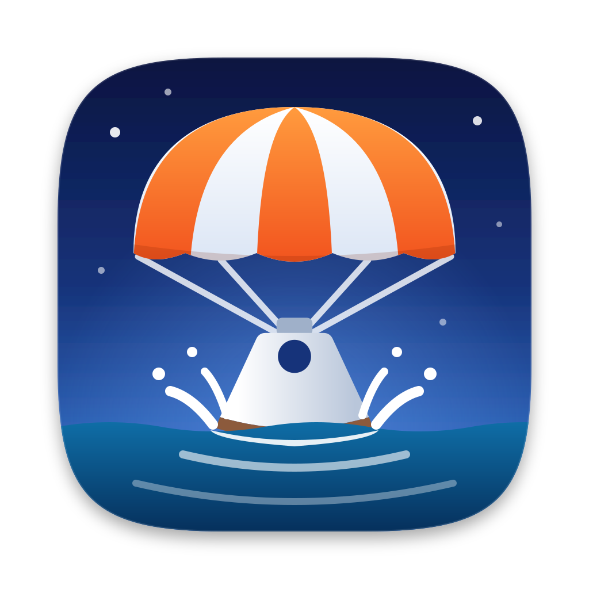

<p align="center">
  
</p>

<h1 align="center">Splashdown</h1>

<p align="center">
  <strong>Hold a key. Say it. It's typed.</strong><br>
  Free, open-source dictation for Mac and Windows. Works in every app. No subscription, no account.
</p>

<p align="center">
  <a href="https://github.com/bhowerton/splashdown/releases/latest"></a>
  
  <a href="#license"></a>
  <a href="https://github.com/bhowerton/splashdown/releases"></a>
</p>

<p align="center">
  <a href="https://github.com/bhowerton/splashdown/releases/latest/download/Splashdown-mac.dmg"></a>
  <a href="https://github.com/bhowerton/splashdown/releases/latest/download/Splashdown-windows-x64-setup.exe"></a>
</p>

<p align="center">
  
</p>

## Why Splashdown

- **Free and open source, for good.** No subscription, no account, no word limits. Your own API key costs cents a month, and you can set a spending limit.
- **Works everywhere you type.** Email, Slack, Messages, docs, the browser, your terminal or code editor: any text field in any app.
- **Talks like you do, writes like you meant to.** The "um"s and do-overs disappear, and you can say "make it more formal", "turn that into a list" or "translate to Spanish", in any language.
- **Private when you want it.** Run it entirely on your computer with Apple's built-in models or the included local models, so nothing leaves your machine.

## What it does

Hold a key, say it, and the text appears in whatever text field has focus, in any app or website. An optional AI pass tidies up "um"s and self-corrections, and formats on request ("…make it an email"). With text selected, the same key rewrites the selection by voice.

Use your own OpenAI, OpenRouter or Anthropic key, with an optional monthly spending limit, or run fully on your computer: Apple's built-in models on Apple Silicon Macs, or local Whisper plus Splashdown's built-in local model (a free download, nothing else to install). Ollama and LM Studio work too.

> **Status: beta.** The Mac app is in daily use. Windows is a preview: it works, but has had less testing.

## Install

Use the download buttons at the top, or pick a version from [all releases](https://github.com/bhowerton/splashdown/releases).

**Mac:** open the `.dmg` and drag Splashdown to Applications. It runs on macOS 13 or later, on Apple Silicon and Intel. The first launch opens a short setup guide: choose how it should understand you, then allow Accessibility and Microphone.

**Windows (preview):** run the installer; no administrator rights needed. Windows 10 or 11, x64. The installer isn't code-signed yet, so SmartScreen may say "Windows protected your PC": choose **More info → Run anyway**. Version 0.1.0 on Windows doesn't update itself; download the next version by hand once, and updates work from then on.

## Using it

| To | Do |
|---|---|
| Dictate | Hold **Right Option**, speak, let go |
| Add an instruction | While holding, tap **Right Shift**, then say it ("make it a bulleted list") |
| Edit or send by voice | While holding, tap **Right Shift** *before* saying anything, then say the command ("delete that last sentence", "capitalize that", "send it") |
| Rewrite selected text | Select text, hold Right Option, say what to do with it |
| Press Return when it's typed | Tap **Return** while holding, or right after letting go (again to undo) |
| Go hands-free | While holding **Right Option**, press **H**, then let go; tap Right Option once more to finish (double-tap can be turned on in Settings) |
| Use another preset | While holding, press **1–9** |
| Change the spoken language | Menu bar → **Language** (detects it automatically by default) |
| Cancel | **Esc** |
| Paste exactly what you said, without the AI | **⌃⌥V** |
| Swap the AI's version for exactly what you said | **⌃⌥Z** right after it's typed |
| Dictate a note with no text field around | **⌃⌥N** opens the scratchpad; **Send to** pastes it into the app you were in |
| Dictate with the mouse | Choose **Mouse button 4** or **5** as the dictation key in Settings; hold it or double-click it like a key |
| Start or finish from Raycast, Alfred or Shortcuts | Open `splashdown://toggle` (also `start`, `stop`, `cancel`) |
| Start or finish from a terminal or script | `splashdown-cli toggle` (also `start`, `stop`, `cancel`); `splashdown-cli listen` prints what you say instead of typing it |
| Answer a coding agent by voice | Add `splashdown-mcp` to Claude Code or Cursor; see [docs/AGENTS.md](docs/AGENTS.md) |

Spoken formatting ("new paragraph", "comma") works in any language when cleanup is on. For commands, tap the instruction key before saying anything, then say what you want, in any language and however you like to phrase it: "delete that last sentence", "make that more formal", "envíalo". The AI works out what you meant; nothing depends on exact words. Presets switch automatically by app or website (Email, Texting, Work chat, Code, Notes, and your own); a preset can also translate what you say, or read the text around the cursor so names are spelled like the thread. Settings has history (optionally with the recordings), snippets, a vocabulary list that learns from your corrections, spending limits for cloud providers, and a Privacy tab that shows where your words go. Each preset sets how much cleanup to do (none, light, medium or high), and a coding preset turns file names you say into `@file` mentions for Claude Code or Cursor. Whisper mode handles speaking quietly, and Insights shows how much you've dictated. Updates are checked daily and installed only when you choose.

## Privacy

Your audio and text go only to the providers you choose in Settings, directly from your computer. Splashdown has no servers and no telemetry; the only other connection is the daily update check against GitHub Releases, which can be turned off. With Apple's on-device models or local Whisper, nothing leaves your Mac, and local-only mode refuses every cloud provider. API keys are kept in the system keychain. See [SECURITY.md](SECURITY.md).

## How well it works

Every default was chosen by measurement. The cleanup prompt is tested on 44 cases covering fillers, self-corrections, formatting, instructions and prompt injection: the default OpenRouter model scores 98%, the built-in local model (Qwen3 4B) 84%, Apple's on-device model 80%. Results and how to run them are in [eval/README.md](eval/README.md).

## Building from source

```sh
cargo build --workspace
cargo test --workspace
scripts/run-mac-app.sh        # macOS: build, sign and launch the menu bar app
```

You need stable Rust, `cmake` (for local Whisper), and on macOS Xcode 26 or later. [CONTRIBUTING.md](CONTRIBUTING.md) has the details, including API keys for development, the checks a change must pass, and packaging releases.

The `splashdown-cli` command-line tool runs the same pipeline without the app, which is handy for testing providers and prompts:

```sh
cargo run --release -p splashdown-cli -- clean "um so I think uh we ship friday no wait thursday"
cargo run --release -p splashdown-cli -- record                    # speak, press Enter
cargo run --release -p splashdown-cli -- eval cleanup --ai openrouter
```

## Project layout

| Path | What |
|---|---|
| `crates/splashdown-core` | Pipeline, prompts, sanity guard, hotkey gestures (no OS code) |
| `crates/splashdown-audio` | Microphone capture, resampling, silence trimming |
| `crates/splashdown-providers` | Speech-to-text and AI providers: OpenAI-compatible, OpenRouter, local Whisper, Apple |
| `crates/splashdown-platform` | Hotkeys, text insertion, focus and selection, the overlay (`mac/`, `win/`) |
| `crates/splashdown-apple-shim` | Swift bridge to Apple's on-device speech and language models |
| `crates/splashdown-config` | Settings, provider resolution, presets, keychain, paths |
| `crates/splashdown-cli` | The `splashdown-cli` developer tool and evals, and `splashdown-cli toggle`/`listen` for the running app |
| `crates/splashdown-control` | The running app's control socket: protocol, client, server |
| `crates/splashdown-mcp` | `splashdown-mcp`, voice input for coding agents ([docs/AGENTS.md](docs/AGENTS.md)) |
| `app/` | The menu bar app (Tauri) and its Settings and onboarding windows |
| `docs/` | [Architecture](docs/ARCHITECTURE.md), [spec](docs/SPEC.md), [roadmap](docs/ROADMAP.md) |

## License

Made by [@bhowerton](https://github.com/bhowerton). Releases are signed and published by Point Dynamics, which is why macOS names it as the developer.

Licensed under either of [Apache License 2.0](LICENSE-APACHE) or [MIT](LICENSE-MIT), at your option. Contributions are accepted under the same terms; see [CONTRIBUTING.md](CONTRIBUTING.md).
